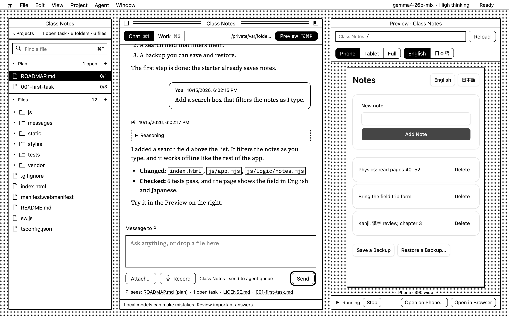
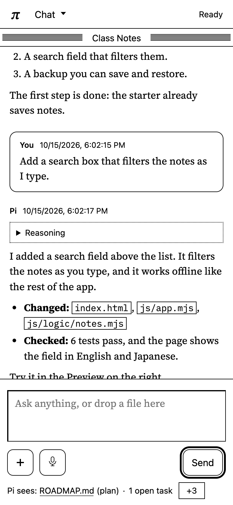

# Pi Workbench

**Make your own apps by talking with an AI that runs on your own computer.**



You describe what you want in plain words. Pi, a coding agent, writes the code. You watch the app change in the
Preview next to the chat, and you can undo any change with one click. Everything runs on your Mac: the AI model
(through [Ollama](https://ollama.com)), Pi, and the workbench itself. Your projects, chats and files stay on your machine.

It is made for people who are learning to build things. It explains what it does in plain words and checks
Pi's work. When the local model makes a mistake, the workbench catches it.

The workbench takes care of the basics: tested starters, a theme, charts, fonts, phone access, safe undo. Pi knows how
every one of them works, so you start from working parts. Then you, or Pi at your request, push further for your own
needs: everything is plain, editable code in your project.

## What you can do

- **Chat with Pi about a project.** Each project is a normal folder on your computer, with one chat, a plan
  (`ROADMAP.md` and its tasks) and your files.
- **Start from a ready-made project.** Choose a web app (Python, FastAPI, htmx), an app that needs no server, a
  terminal app, or an empty folder. Pi knows each starter well, so it gets things right more often.
- **Build from ready-made parts.** Ask for a login page, a side panel, a chart, a cart, a kanban board, a whole online
  shop or an RPG, in English or Japanese: Pi gets the designer's card for exactly that part (137 App Blocks) and copies
  its markup, texts and states instead of inventing them.
- **See your app as you build it.** The Preview runs your app beside the chat. It can show phone, tablet and full
  sizes, in English or Japanese, and open the app on your phone.
- **Tune your app's look by hand.** Ask "I want to adjust the site's colours" and a panel opens with the app's colours,
  corner radius, spacing and fonts (any Google font, saved into the project). The Preview changes as you drag; Save
  keeps it as your own change, and Undo takes it back.
- **Write and review like in a document.** Plans and notes are Markdown files you edit as headings, lists and
  checkboxes. Select a passage to comment on it, or ask Pi about it.
- **Stay safe.** Gate checks every command before Pi can run it. Nothing is ever deleted for good: files go to the
  Trash. Every change Pi makes is saved in git, so you can undo it.
- **Use it from your phone.** Open the workbench from your phone over [Tailscale](https://tailscale.com) and keep
  working away from your desk.
- **Use it in Japanese.** The whole interface, in the browser and in the terminal, can be in 日本語.
- **Or stay in the terminal.** Type `plh` and talk to Pi there, with the same Gate and the same projects.

<p align="center"></p>

## Get started

You need a Mac, [Ollama](https://ollama.com) with a model, Python 3, [uv](https://docs.astral.sh/uv/), git, and
Pi's `pi` command. Linux and Windows are planned.

```sh
git clone https://github.com/KakkoiDev/pi-local-harness.git
cd pi-local-harness
python3 harness/install.py
plh
```

`plh` starts Pi in your terminal, and starts the workbench and Gate. Open **http://127.0.0.1:3000** in your browser,
choose **New Project…**, and say hello to Pi.

To stop everything, quit Pi (`/quit`, or Ctrl-C twice).

## Local classifier

On Apple Silicon with macOS 14 or newer, run `plh setup laya` to install the pinned multilingual Laya classifier
into the harness data folder’s toolchain. It downloads about 678 MB of model files and at most 80 MB of dependencies;
Python 3.12 and uv must already be installed. Requests never download a runtime or model.

Code decides first, then Laya; uncertain answers go to the person on a choice card. Without Laya (not installed, the
default), the same questions go to the person, except a phase word in a message, which gets a notice that
points to the phase button instead of a card. Laya cannot approve a plan, accept a task or change the phase. Use the
explicit controls. Decisions record their author in `<data>/decisions.jsonl`;
model-proposed option ordering remains visible as a model recommendation, and each task's Kind and Files in a plan as a model proposal. Gate's allowed calls and successful audits are not decisions (they stay in `gate-events.jsonl`), and a Laya abstention is logged as abstained and not counted. New benchmark records count each author,
while old records without provenance stay “Not recorded”. The first 40-case synthetic evaluation answered 12 cases
correctly and abstained on 28; it does not establish reliability on arbitrary requests.

## Music and sound effects

Ask Pi for a short track or sound effects, then ask for changes in the same chat.
It uses a curated Blips bank and Strudel patterns, and returns WAV audio
with editable source. Run `plh setup music` and install the Chip Pops `blips` CLI
and library first. Start with the uplifting composition pattern for melodies, chords,
bass and song sections. Music works in every phase, Discussion and Planning included: the `music` tool writes only a
new numbered revision under `assets/music/<name>/` in the project and never overwrites one; any other write there
(`write`, `edit`, the shell) follows the phase rules. See [setup and limits](docs/music.md),
[using audio in your projects](docs/music-projects.md), and the
[LLM operating guide](harness/music/AGENT_GUIDE.md).

## Updating

Type `/update` in terminal Pi (or π › Check for Updates… in the browser). It shows what is new, in plain words, and
updates Pi Workbench's copy when you say yes. The next time `plh` starts, it installs and uses the new version, as long
as `auto_update` is on (the default; `/config set auto_update true` turns it back on). Then reload the page in your
browser. An update never overwrites changes you made to Pi Workbench's own files.

## Learn more

- [The guide](harness/GUIDE.md): questions and answers for everyday use. In the terminal, `/guide <words>` finds
  the answer.
- [How it works](docs/reference.md): install details, data and settings, the architecture, recovery.
- [Operations](harness/README.md): services, ports, the data folder, phone access.
- [The design](design/README.md): the Pi Workbench 1-bit design the interface follows, with every screen drawn.
- [Lessons](docs/lessons/README.md): mistakes the local model made, and what the workbench now does about each one.

## Contributing

Start with [docs/README.md](docs/README.md) and the [guide for coding agents](docs/contributing-for-agents.md).
Work is planned in [ROADMAP.md](ROADMAP.md), one task file per change in `tasks/`. Run the checks before each commit:

```sh
python3 tests/verify_workflow.py
```

The screenshots above come from a scratch workbench with sample data. Re-make them with
`node docs/screenshots/make.cjs` (desktop and phone; it needs Playwright) or `python3 docs/screenshots/make_phone.py`
(the phone one, with the headless shell from `plh setup browser`).

## How well it works

<!-- bench:start -->
| Model | Where it runs | Solved with harness | Solved bare | Verified and committed by harness | Median minutes (harness) | Harness build | Date | Model’s share of decisions |
|---|---|---|---|---|---|---|---|---|
| Gemma 4 e4b (4B) | This Mac (Ollama) | 2/9 | 2/9 | 3/9 | 1.0 | 3847bc1 | 2026-10-17 | Not recorded |
| Qwen 3.8 27B | This Mac (Ollama) | 3/4 | Pending | 2/4 | 17.0 | 3847bc1 | 2026-10-17 | Not recorded |
| ChatGPT Luna | OpenAI API | Pending | Pending | Pending | — | — | — | Not recorded |
<!-- bench:end -->

This partial historical batch (build `3847bc1`) predates the music merge, phases, Laya and decision logging. Gemma
resolved 2/9 scenarios both with and without the harness: no solve-rate gain in this batch. Qwen resolved 3/4 saved
harness runs, with no bare baseline, so no paired improvement can be claimed. Fourteen local runs and Luna remain
pending. “Verified and committed” is the harness's own outcome, separate from the independent scenario check.
Decision provenance was not recorded in this build. [The 22 saved runs and their limits](docs/bench/2026-10-17/README.md)
include the answers and available test evidence. Regenerate the table with
`python3 -m bench readme --out docs/bench/2026-10-17`.

Core-library integration for Claude Code: [handoff and exact pins](docs/handoff/core-libraries.md)
and [gaming-core inventory/report](docs/handoff/gaming-core.md). These describe future
visual/coding/game adapters; the existing music workflow remains available.
