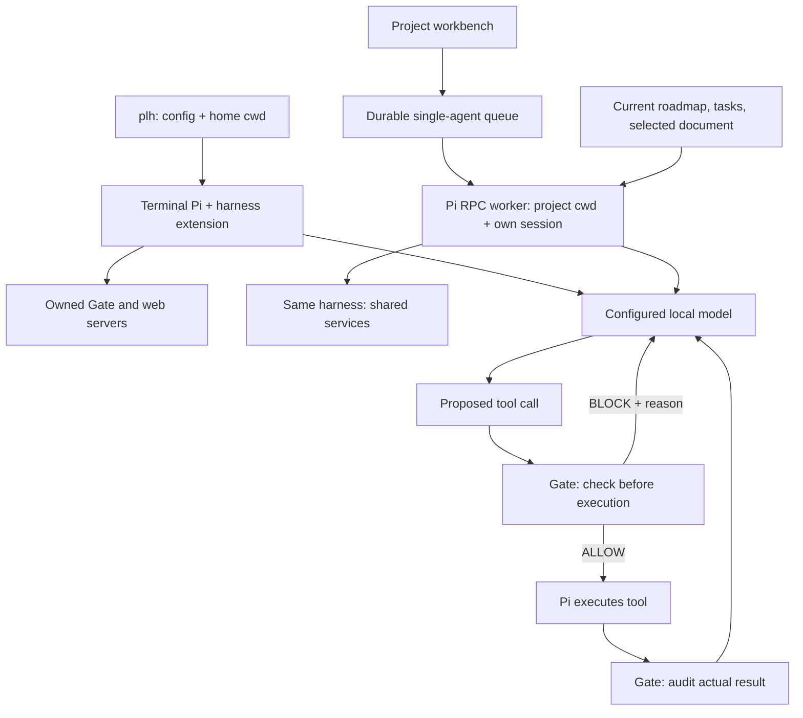

# Pi Workbench: reference

How Pi Workbench works in detail: install and update, projects and chat, data and configuration, the architecture, recovery, where to change things. For a first look, see [the README](../README.md).

New here? [harness/GUIDE.md](../harness/GUIDE.md) answers the common questions (starting, opening the workbench, projects,
comments, models, the phone, settings, trouble). In terminal Pi, `/guide <words>` prints the matching answers, and Pi
itself reads them when you ask how to do something.

A local workbench for **one agent, one chat per project, and real Markdown files**.
Start `plh` (or `pi-local-harness`) from any directory. It starts Pi in your home
directory, Gate on port **8000**, and the web workbench on **3000**. Plain `pi` keeps
its normal behavior. Whisper loads only when you submit audio.

## Install and start

Requirements: Pi's `pi` command, Python 3, a running local Ollama-compatible model
server, and `uv` for audio transcription.

```sh
python3 harness/install.py
plh
# From a checkout, without installing:
./start.sh
```

The installer copies the runtime into `~/.local/share/pi-local-harness` and creates
`~/.local/bin/plh` and `~/.local/bin/pi-local-harness`. Put `~/.local/bin` on your PATH
if necessary. The installed runtime survives moving or deleting the checkout.

`plh` follows the checkout it was installed from. On each launch it compares the
checkout's committed `HEAD` with the installed build; if they differ it installs that
commit (`git archive`, so uncommitted edits never ship) and prints `PLH: updated to
<commit>`. If the checkout is gone or the update fails it prints `PLH: not updated` and
starts the installed build. Set `"auto_update": false` in `config.json` to stop this.
A running session keeps its build until you restart `plh`. Re-run the installer by hand
only to install from a different checkout. Each install backs up the previous one and
keeps the three newest backups, and detaches the recognized old global harness extension and its model defaults,
preserving unrelated Pi settings, packages, extensions, and custom instructions.

After installing an update, close the running PLH session, start `plh` again,
and reload the browser. Servers retain their loaded Python code until restarted;
mixing an old server with newly installed browser modules can leave all tabs
unresponsive. A module loading failure now displays these recovery instructions.

The console prints actual service URLs once, as colored, underlined terminal links.
They scroll away with the transcript. Startup fails clearly if a configured port is
already occupied; it never kills another process. Closing Pi stops its services.

## Projects, documents, and chat

Open the printed Web URL. **New project** lets you choose a parent directory and
creates a folder with `ROADMAP.md` and `tasks/001-first-task.md`. **Add existing
folder** registers any accessible folder in place; it does not move its files.
Projects can live anywhere. Registration alone does not create or overwrite docs.

The left window starts as the Projects home (`/projects`) with a search field (⌘/Ctrl K); choosing a project shows what is inside it, Plan (ROADMAP.md, tasks) above Files, in every view, and “‹ Projects” goes back. The address bar follows you: `/p/<project>/work/<file>`, Back and Forward work, and a link opens the same place. Project and
file searches stay scoped to their lists. The browser remembers the last project,
view, and selected document. First-run actions guide you to create/register a folder. Each project has exactly one persistent chat.
The **Work** tab shows its actual folder, searchable file tree, active work, roadmap,
and task documents. Edit Markdown as heading, paragraph, list, checkbox, quote,
and code blocks, or switch to Markdown source. Unsupported Markdown is retained
as raw text; this is a small block editor, not a complete Notion renderer.
Changes autosave to the actual files. Concurrent filesystem changes produce a
version conflict rather than silently overwriting your draft. To rename, move or
delete, select a file (click it) or a folder (click its row), then use File ›
**Rename or Move…** or **Move to Trash…** (⌘⌫). Trash moves the file or folder, with
its comment threads, into the data directory's `.trash`; nothing is deleted.
Undo in the toast moves it back.

The **Project** menu acts on the open project: **Rename Project…** (renames its folder),
**Move Project…** (into another folder), **Remove from List…** (the folder stays on your Mac) and
**Move Project to Trash…** (the Mac Trash, so the Finder's Put Back works). The project keeps its id,
so its address, chat, comments and Activity stay with it; adding a removed or trashed folder again
with **Add Existing Folder…** brings the same project back. A project whose folder went missing
opens its chat with **Locate Folder…**. These wait while Pi works in that project, and while Pi works in
the terminal. On a phone, the
⋯ on each project row in the π sheet holds the same commands.

**Ask Pi about this whole file**, at the bottom of Review, sends a request about the whole page.
Its request and result remain attached to that document. Comment and whole-file requests run
as one-off Pi requests with their own context; they never appear in, or use up, the project chat.
For a specific passage, select its text: a small bar offers **Comment** (⇧⌘M) and **Ask Pi…**.
A comment stays with the file until you choose **Ask Pi** on it (in its thread or in Review), or
**Send N Unsent Comments to Pi**. In a thread, **Add Note** keeps a reply with the file; **Ask Pi**
sends the whole thread with what you typed, and Pi's answers are added below, in order.
Anchors must match a unique passage in the current file. Changed passages retain the original
quote rather than silently moving.

**Activity · All Projects** (Window menu ⌘3, the Agent section of the Projects window, or the
status in the menu bar) shows running, waiting, completed, stopped, failed, and interrupted
tasks of every project. A request that paused for a question or a plan is waiting for you (“Stopped by a question:
waiting for your answer”, or for Start Building), not completed; it completes when you answer or act on the plan. A
request you stopped says “Stopped by you”. Messages you send while Pi works join your waiting message; an answer to a
question, Start Building and Continue are requests of their own and never join it (an answer goes first). Filter by project or state, open the source chat/document,
inspect the Markdown record, cancel waiting work, or stop active work. Requests
enter one durable FIFO queue. You can browse another project while it runs.
Interrupted work is never automatically repeated.

Chat text drafts and unsaved document drafts survive browser reloads in local
storage. Attachments remain in the current tab until sent. Version conflicts keep
your draft intact: download it, retry transient failures, or explicitly reload
from disk. ⌘/Ctrl S saves; live polling preserves unchanged content and thread
reply drafts. A Reconnect action appears after service connection failures.

Every queued turn starts a Pi RPC worker in that project's folder, resumes **only
that project's Pi session**, and gives Pi a small context chosen for the request
(`harness/context.py`): the compressed roadmap and open tasks, the current document,
files you mention, a few related files, and the file names, within about 4k tokens.
It goes into the system prompt for that turn only, so it never fills the chat history.
Document requests also include the selected current document. Switching back
restores that project's conversation; it never merges other project chats. Older
conversation context can be compacted by Pi. Scope is an instruction and cwd, not
a filesystem sandbox.

Files and work progress refresh roughly every two seconds. Text/code files are
viewable and editable; binary files are listed but not rendered as text. The tree
skips `.git`, dependency/cache folders, and symlinks, with a 2,000-file limit.
The text viewer limits files to 512 KB. The chosen context is bounded to 16,000
characters per turn, with 3,000 per chosen file and 6,000 for the current document
(a larger one is cut to the passage's section plus its headings). `GET /api/context-preview?project=&text=`
(with `document=`, or `path=&comment=` for a thread) returns what that request would carry:
the file names with their kind (plan, this file, mentioned, related), the open-task count
and the size in tokens. The "Pi sees:" line under the chat composer, the comment composer, an unsent
thread and the whole-file box shows those items before you send.

## Data and configuration

`~/pi-local-harness-data` contains shared `AGENTS.md`, `config.json`, `.projects.json`
(folder registry), `model.json` (the model and thinking level chosen in the menu bar),
`gate-events.jsonl` (Gate's checks, kept across restarts), `activity/` (one Markdown task
record per request), `.comments/` (Markdown threads), `.trash/`, and `chats/` (metadata,
Pi session files, uploads). `projects/` stores projects created through the API
without a chosen external parent. Registered external projects stay in place.
Task and comment records have authoritative frontmatter and readable Markdown
bodies. Existing JSON queue/comment records are migrated with backups. Binary
attachment payloads and Pi session/registry/config internals retain their native
formats. Task records include prompts, states, timestamps, outcomes, and links to
their chat/document. Chat transcripts are never automatically copied into shared memory.

The first `plh` launch creates this directory, a default `config.json`, and
`AGENTS.md` if they are missing. Later launches preserve existing configuration.

Edit `~/pi-local-harness-data/config.json`, then restart `plh`:

```json
{
  "effort": "high",
  "gate_port": 8000,
  "web_port": 3000,
  "whisper_model": "mlx-community/whisper-base-mlx",
  "remote_hosts": [],
  "remote_users": [],
  "auto_update": true
}
```

`remote_hosts` and `remote_users` open the web UI to your phone through
`tailscale serve`; see [Phone access over Tailscale](../harness/README.md#phone-access-over-tailscale-and-voice-input).

`effort` is the default thinking level. Choose the model and the thinking level from the
menu bar (click the model name or "High thinking"): the menus list the installed Ollama
models, switching unloads the previous model so only one stays in memory, and a model that
does not think dims the thinking menu. The choice is saved in `model.json` in the data
directory and used by terminal Pi (from its next start) and browser workers.
`harness/model.json` is the default model (`ollama/gemma4:26b-mlx`); a `model` in
`config.json` is not supported and stops `plh` with an error. Port `0`
selects an available port. `PI_AGENT_DATA` selects a different data directory;
`PI_GATE_PORT` and `PI_WEB_PORT` override ports. See the
[operations guide](../harness/README.md) for other environment settings.

## Architecture: who does what



**The model proposes. Gate checks. Pi executes.** Browser workers reuse existing
services; they never launch a second web/Gate pair. A shared process lock prevents
overlapping terminal and browser agent turns within the same data directory.

Gate runs at Pi's `tool_call` event **before execution**. Allowed proposals receive
a one-use ID. Blocked proposals never execute; specific corrective feedback guides
the model's next reasoning step. After `tool_result`, an audit checks the original
proposal, execution status, and write/edit postconditions. Gate failures fail
closed; failed/unavailable audits become failed tool results.

Inside a project, the phase decides which shell commands run (G-015, `gate/phase_shell.py`). Discussion and Planning
run only checked reads: `ls`, `cat`, `head`, `tail`, `wc`, `grep`, `rg`, `find`, `diff`, `sed -n <lines>p` and `pwd`,
joined by `|` if needed, with no globs, `$`, `;` or redirection; Git only in its read form,
`git --no-pager --no-optional-locks -c core.fsmonitor=false status` or
`git --no-pager --no-optional-locks -c core.fsmonitor=false diff --no-ext-diff --no-textconv` (plain `git status`
is refused: it can write the index and run hooks). Implementation adds the project's checked test runners (offline
and no-install forms: `npx --no-install`, `uv run --offline`, `cargo test --offline`; no `go test`); anything else
(builds, installs, `git commit`, downloads) is refused and the refusal says what may run. Outside any project the
destructive guard alone applies: ordinary commands run; broad deletion (`rm -fr *`), root/home deletion, disk
erasure, raw disk writes and recursive system permission changes are blocked. Common shell wrappers are checked. This
is an accident guard, not a sandbox for arbitrary scripts. [Rules and sources](../specs/shell-safety.md).
**Gate · All Projects** (Window menu ⌘4) shows the actual shared ledger: checks, arguments,
outcomes, reasons, project and source (web or terminal). Checks are saved in
`gate-events.jsonl` and the latest 200 come back after a restart.

## Recovery, memory, media, and timestamps

A request has no time limit: long work is fine, and Gate checks every command it runs. It fails only when Pi has sent
nothing (no step, no output, no tool event) for an hour; time paused while Pi answers the chat does not count. Set
`PI_HARNESS_SILENCE_SECONDS` to change that. Stop ends a request at any time.

### Commit protocol

Within a request, the harness commits (G-013): Pi's own `git commit` is refused. At the end of a request that changed
files, the harness commits locally what the request changed inside its task's `Files:` (with Git hooks off). The
change is verified, and its task and ROADMAP.md line ticked done, only from evidence: a test run that passed on the
final code, and a failure of that test without the change (a run Gate saw, or the harness's own proof in a temporary
copy of the project; a `--help` run or a run where no test ran does not count). Otherwise the commit is marked “not
verified” and the task stays open; in a plan, a check-in waits for the person. Undo This Request reverts it.

Outside a request (a commit typed in a project folder through Pi's tools, the bench's bare mode), Gate still applies
the older commit order (G-005): in a project folder with `ROADMAP.md` and `tasks/`, Gate revises any `git commit`
until it has seen, since the last commit: a failing test run, a code change, a
passing test run on exactly the code being committed, a newly checked `- [x]` box in
a `tasks/*.md` file, and one in `ROADMAP.md`. Each checked task file needs a
`Kind:` line: `code` needs red and green, `chore` needs green, `docs` and `planning`
need no runs and may not change code. A commit that only adds unchecked tasks to
`ROADMAP.md` and `tasks/` is a planning commit; each task file it touches needs a
`Kind:` line. Test runs count only when the runner (unittest, pytest, `node --test`,
npm/yarn/pnpm/bun test, vitest, jest, go/cargo/make test) is the last command and
no pipe or `||` hides its exit code; stopped, killed, or timed-out runs are ignored.
Evidence is git state plus runs Gate observed, kept in
`~/pi-local-harness-data/gate-protocol.json` across restarts. It checks the protocol; a
commit made outside Pi's tools, or through an unrecognized wrapper, is not seen.

Every **10 seconds**, the watchdog checks the latest 100 nonempty thought lines.
Two non-overlapping occurrences of the same consecutive three lines trigger
recovery. A thought phase with no active Pi operation, or 60 seconds without
streamed activity, triggers hang recovery. Normal idle and tool execution are
exempt. Pi exposes operation/stream state, not definitive GPU utilization.

Recovery aborts, waits for the turn to end, compacts, reloads shared `AGENTS.md`,
and reasks the original question with previous reasoning and the incident. Missing
`[CANARY]` in completed assistant text follows the same path. The harness wakes Pi at
most `wake_ups` times per request (config.json or `PI_HARNESS_WAKE_UPS`, default 5, 0 for no limit): recoveries and
its "continue" wake-ups (code changed and no test passed on it yet, a plan left incomplete, the starter sample) count
together; then it stops and offers Ask Pi to Retry…. Memory reloads before every turn. The agent can record
verified lessons/preferences in `AGENTS.md` with write or edit in any phase (Gate exempts that one file, size-guarded:
at most 32 KiB, 4 KiB more at a time); automatic incident lessons are currently fixed and
deduplicated by kind. Evidence-verified promotion remains an open roadmap task.

Paste accessible image/audio paths in terminal Pi (quote paths containing spaces),
or attach/drop/paste images and text files in web chat. Images are passed as bytes.
Audio uses lazy local MLX Whisper speech transcription; the transcript goes to
Gemma. This does not mean the 26B model consumes native audio or interprets
non-speech sounds. First audio use may install dependencies/download weights;
startup does not load Whisper. Microphone recording needs browser permission;
the recording is transcribed into the prompt box for review before sending.
Uploads support images, common audio, and UTF-8 text/code: eight files, 12 MiB each,
20 MiB total in the UI. Unsupported binary formats return an error.

Question, assistant, tool, and completion events receive local timestamps in Pi.
Web messages and queue jobs also record timestamps. Services bind to loopback and
reject foreign browser origins. Gate also requires a per-run `X-Gate-Token` that
`services.py` hands only to the Pi extension and web-started Pi processes (in a private file the
extension reads once; it removes the token and Gate's port from its environment, so the commands Pi runs
never inherit them); it sends no CORS headers, so web pages cannot query it. The person's controls (phase,
Start Building, check-ins, Run on its own, choice answers) also need the page's per-run secret. The layout supports mobile sizes; physical-phone
access needs a separate connection setup.

For local music and sound creation, see [music setup and limits](music.md). The optional
`music` tool uses a saved Blips bank and Strudel event patterns, preserving numbered
revisions. Its successful files join the existing chat attachments and audio player.
See [application integration and source reuse](music-projects.md) and the
[LLM music guide](../harness/music/AGENT_GUIDE.md).

## Where to change things

| File | Responsibility |
|---|---|
| `plh.py`, `harness/install.py` | Dedicated launcher, config, stable installation |
| `harness/extension.mjs` | Pi hooks, memory, recovery, service ownership |
| `harness/services.py` | Gate/web sockets and shutdown |
| `harness/web_chat.py`, `harness/work_queue.py` | Project chat, uploads, RPC, FIFO jobs |
| `harness/documents.py` | Folder registry, Markdown, revisions, comments |
| `index.html`, `chat.css`, `js/chat.mjs`, `js/workspace.mjs` | Project workbench |
| `js/markdown-blocks.mjs` | Loss-preserving Markdown block conversion |
| `gate/engine.py`, `gate/shell_guard.py`, `gate/ledger.py` | Gate, shell rules, audits |
| `harness/media.mjs`, `harness/transcribe.py` | Image paths and lazy speech input |
| `ROADMAP.md`, `tasks/` | Completed and remaining work |

Changing this repository? Start with [docs/README.md](../docs/README.md) and the
[contributing guide for coding agents](../docs/contributing-for-agents.md).

Run `python3 -m unittest discover -s tests`, `node --test tests/harness/*.test.mjs`,
and `python3 tests/verify_workflow.py`. Browser regression instructions are in
[the operations guide](../harness/README.md). Browser/RPC fixtures test boundaries;
they do not claim to measure model intelligence.

## UX design guidance

This workbench uses [Impeccable](https://github.com/pbakaus/impeccable) polish and
hardening guidance. [PRODUCT.md](../PRODUCT.md) records product constraints;
[DESIGN.md](../DESIGN.md) records the visual rules (Pi Workbench 1-bit); [design/](../design/README.md) holds the design system, the canvas, the served CSS and icons, and the build guide. Text-selected comments
were informed by [Jikko's comment implementation](https://github.com/KakkoiDev/jikko/blob/main/comments.go); PLH stores threads in adjacent data-directory Markdown records
to keep project document bodies directly editable.
