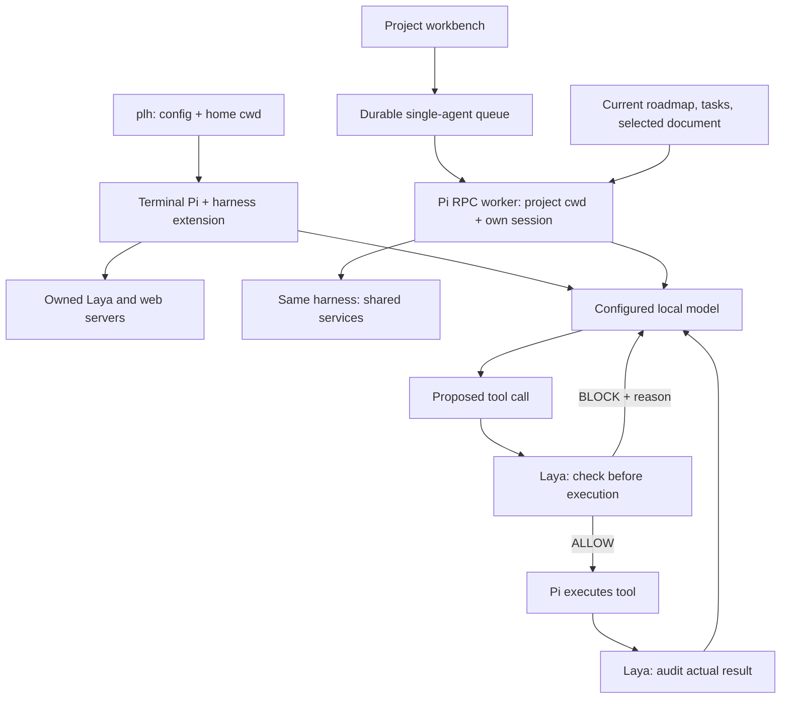

# Pi local harness

A local workbench for **one agent, one chat per project, and real Markdown files**.
Start `plh` (or `pi-local-harness`) from any directory. It starts Pi in your home
directory, Laya on port **8000**, and the web workbench on **3000**. Plain `pi` keeps
its normal behavior. Whisper loads only when you submit audio.

## Install and start

Requirements: Pi's `pi` command, Python 3, a running local Ollama-compatible model
server, and `uv` for audio transcription.

```sh
python3 harness/install.py
plh
# From a checkout, without installing:
./start.sh
```

The installer copies the runtime into `~/.local/share/pi-local-harness` and creates
`~/.local/bin/plh` and `~/.local/bin/pi-local-harness`. Put `~/.local/bin` on your PATH
if necessary. The installed runtime survives moving or deleting the checkout.
Re-run the installer after updating the source. It backs up previous installations
and detaches the recognized old global harness extension and its model defaults,
preserving unrelated Pi settings, packages, extensions, and custom instructions.

After installing an update, close the running PLH session, start `plh` again,
and reload the browser. Servers retain their loaded Python code until restarted;
mixing an old server with newly installed browser modules can leave all tabs
unresponsive. A module loading failure now displays these recovery instructions.

The console prints actual service URLs once, as colored, underlined terminal links.
They scroll away with the transcript. Startup fails clearly if a configured port is
already occupied; it never kills another process. Closing Pi stops its services.

## Projects, documents, and chat

Open the printed Web URL. **New project** lets you choose a parent directory and
creates a folder with `ROADMAP.md` and `tasks/001-first-task.md`. **Add existing
folder** registers any accessible folder in place; it does not move its files.
Projects can live anywhere. Registration alone does not create or overwrite docs.

The left sidebar contains projects and a search field (⌘/Ctrl K). Project and
file searches stay scoped to their lists. The browser remembers the last project,
view, and selected document. First-run actions guide you to create/register a folder. Each project has exactly one persistent chat.
The **Work** tab shows its actual folder, searchable file tree, active work, roadmap,
and task documents. Edit Markdown as heading, paragraph, list, checkbox, quote,
and code blocks, or switch to Markdown source. Unsupported Markdown is retained
as raw text; this is a small block editor, not a complete Notion renderer.
Changes autosave to the actual files. Concurrent filesystem changes produce a
version conflict rather than silently overwriting your draft. Trash moves Markdown
pages into the data directory's `.trash`.

**Document discussion**, above the document, sends a request about the whole page.
Its request and result remain attached to that document. For a specific passage,
select its text, use **Comment on selection**, and add a text comment. The quoted
passage is highlighted; clicking the quote returns to it. Threads support replies
and Resolve/Reopen. Use **Ask agent about this passage** to send that thread;
unsent comments do nothing. Anchors must match a unique passage in the current
file. Changed passages retain the original quote rather than silently moving.

The **Activity** tab shows running, waiting, completed, stopped, failed, and
interrupted tasks. Filter by project or state, open the source chat/document,
inspect the Markdown record, cancel waiting work, or stop active work. Requests
enter one durable FIFO queue. You can browse another project while it runs.
Interrupted work is never automatically repeated.

Chat text drafts and unsaved document drafts survive browser reloads in local
storage. Attachments remain in the current tab until sent. Version conflicts keep
your draft intact: download it, retry transient failures, or explicitly reload
from disk. ⌘/Ctrl S saves; live polling preserves unchanged content and thread
reply drafts. A Reconnect action appears after service connection failures.

Every queued turn starts a Pi RPC worker in that project's folder, resumes **only
that project's Pi session**, and includes fresh roadmap/tasks and file inventory.
Document requests also include the selected current document. Switching back
restores that project's conversation; it never merges other project chats. Older
conversation context can be compacted by Pi. Scope is an instruction and cwd, not
a filesystem sandbox.

Files and work progress refresh roughly every two seconds. Text/code files are
viewable and editable; binary files are listed but not rendered as text. The tree
skips `.git`, dependency/cache folders, and symlinks, with a 2,000-file limit.
The text viewer limits files to 512 KB. Roadmap/task context is bounded to 60,000
characters per turn, with a 12,000-character limit per document.

## Data and configuration

`~/pi-local-harness-data` contains shared `AGENTS.md`, `config.json`, `.projects.json`
(folder registry), `activity/` (one Markdown task record per request),
`.comments/` (Markdown threads), `.trash/`, and `chats/` (metadata,
Pi session files, uploads). `projects/` stores projects created through the API
without a chosen external parent. Registered external projects stay in place.
Task and comment records have authoritative frontmatter and readable Markdown
bodies. Existing JSON queue/comment records are migrated with backups. Binary
attachment payloads and Pi session/registry/config internals retain their native
formats. Task records include prompts, states, timestamps, outcomes, and links to
their chat/document. Chat transcripts are never automatically copied into shared memory.

The first `plh` launch creates this directory, a default `config.json`, and
`AGENTS.md` if they are missing. Later launches preserve existing configuration.

Edit `~/pi-local-harness-data/config.json`, then restart `plh`:

```json
{
  "effort": "high",
  "laya_port": 8000,
  "web_port": 3000,
  "whisper_model": "mlx-community/whisper-base-mlx"
}
```

Both terminal Pi and browser workers use this effort. The model is pinned to
`ollama/gemma4:26b-mlx` in `harness/model.json`; a different `model` in `config.json`
stops `plh` with an error. Change the pin only in that file. Port `0`
selects an available port. `PI_AGENT_DATA` selects a different data directory;
`PI_LAYA_PORT` and `PI_WEB_PORT` override ports. See the
[operations guide](harness/README.md) for other environment settings.

## Architecture: who does what



**The model proposes. Laya checks. Pi executes.** Browser workers reuse existing
services; they never launch a second web/Laya pair. A shared process lock prevents
overlapping terminal and browser agent turns within the same data directory.

Laya runs at Pi's `tool_call` event **before execution**. Allowed proposals receive
a one-use ID. Blocked proposals never execute; specific corrective feedback guides
the model's next reasoning step. After `tool_result`, an audit checks the original
proposal, execution status, and write/edit postconditions. Gate failures fail
closed; failed/unavailable audits become failed tool results.

Ordinary shell commands work in both profiles: `env`, `ls /`, `whoami`, builds,
tests, and scoped cleanup such as `rm -rf ./build`. Broad deletion (`rm -fr *`),
root/home deletion, disk erasure, raw disk writes, and recursive system permission
changes are blocked. Common shell wrappers are checked. This is an accident guard,
not a sandbox for arbitrary scripts. [Rules and sources](specs/shell-safety.md).
The **Laya** tab shows the actual shared ledger: checks, arguments, outcomes,
reasons, and timestamps. Its latest 200 events reset when services restart.

## Recovery, memory, media, and timestamps

### Commit protocol

In a project folder with `ROADMAP.md` and `tasks/`, Laya revises any `git commit`
until it has seen, since the last commit: a failing test run, a code change, a
passing test run on exactly the code being committed, a newly checked `- [x]` box in
a `tasks/*.md` file, and one in `ROADMAP.md`. Each checked task file needs a
`Kind:` line: `code` needs red and green, `config` needs green, `docs` and `planning`
need no runs and may not change code. A commit that only adds unchecked tasks to
`ROADMAP.md` and `tasks/` is a planning commit; each task file it touches needs a
`Kind:` line. Test runs count only when the runner (unittest, pytest, `node --test`,
npm/yarn/pnpm/bun test, vitest, jest, go/cargo/make test) is the last command and
no pipe or `||` hides its exit code; stopped, killed, or timed-out runs are ignored.
Evidence is git state plus runs Laya observed, kept in
`~/pi-local-harness-data/laya-protocol.json` across restarts. It checks the protocol; a
commit made outside Pi's tools, or through an unrecognized wrapper, is not seen.

Every **10 seconds**, the watchdog checks the latest 100 nonempty thought lines.
Two non-overlapping occurrences of the same consecutive three lines trigger
recovery. A thought phase with no active Pi operation, or 60 seconds without
streamed activity, triggers hang recovery. Normal idle and tool execution are
exempt. Pi exposes operation/stream state, not definitive GPU utilization.

Recovery aborts, waits for the turn to end, compacts, reloads shared `AGENTS.md`,
and reasks the original question with previous reasoning and the incident. Missing
`[CANARY]` in completed assistant text follows the same path. One automatic retry
is allowed per question. Memory reloads before every turn. The agent can record
verified lessons/preferences; automatic incident lessons are currently fixed and
deduplicated by kind. Evidence-verified promotion remains an open roadmap task.

Paste accessible image/audio paths in terminal Pi (quote paths containing spaces),
or attach/drop/paste images and text files in web chat. Images are passed as bytes.
Audio uses lazy local MLX Whisper speech transcription; the transcript goes to
Gemma. This does not mean the 26B model consumes native audio or interprets
non-speech sounds. First audio use may install dependencies/download weights;
startup does not load Whisper. Microphone recording needs browser permission.
Uploads support images, common audio, and UTF-8 text/code: eight files, 12 MiB each,
20 MiB total in the UI. Unsupported binary formats return an error.

Question, assistant, tool, and completion events receive local timestamps in Pi.
Web messages and queue jobs also record timestamps. Services bind to loopback and
reject foreign browser origins. Laya also requires a per-run `X-Laya-Token` that
`services.py` hands only to the Pi extension and web-started Pi processes; it sends
no CORS headers, so web pages cannot query it. The layout supports mobile sizes; physical-phone
access needs a separate connection setup.

## Where to change things

| File | Responsibility |
|---|---|
| `plh.py`, `harness/install.py` | Dedicated launcher, config, stable installation |
| `harness/extension.mjs` | Pi hooks, memory, recovery, service ownership |
| `harness/services.py` | Laya/web sockets and shutdown |
| `harness/web_chat.py`, `harness/work_queue.py` | Project chat, uploads, RPC, FIFO jobs |
| `harness/documents.py` | Folder registry, Markdown, revisions, comments |
| `index.html`, `chat.css`, `js/chat.mjs`, `js/workspace.mjs` | Project workbench |
| `js/markdown-blocks.mjs` | Loss-preserving Markdown block conversion |
| `laya/engine.py`, `laya/shell_guard.py`, `laya/ledger.py` | Gate, shell rules, audits |
| `harness/media.mjs`, `harness/transcribe.py` | Image paths and lazy speech input |
| `ROADMAP.md`, `tasks/` | Completed and remaining work |

Run `python3 -m unittest discover -s tests`, `node --test tests/harness/*.test.mjs`,
and `python3 tests/verify_workflow.py`. Browser regression instructions are in
[the operations guide](harness/README.md). Browser/RPC fixtures test boundaries;
they do not claim to measure model intelligence.

## UX design guidance

This workbench uses [Impeccable](https://github.com/pbakaus/impeccable) polish and
hardening guidance. [PRODUCT.md](PRODUCT.md) records product constraints;
[DESIGN.md](DESIGN.md) records the existing visual system. Text-selected comments
were informed by [Jikko's comment implementation](https://github.com/KakkoiDev/jikko/blob/main/comments.go); PLH stores threads in adjacent data-directory Markdown records
to keep project document bodies directly editable.
