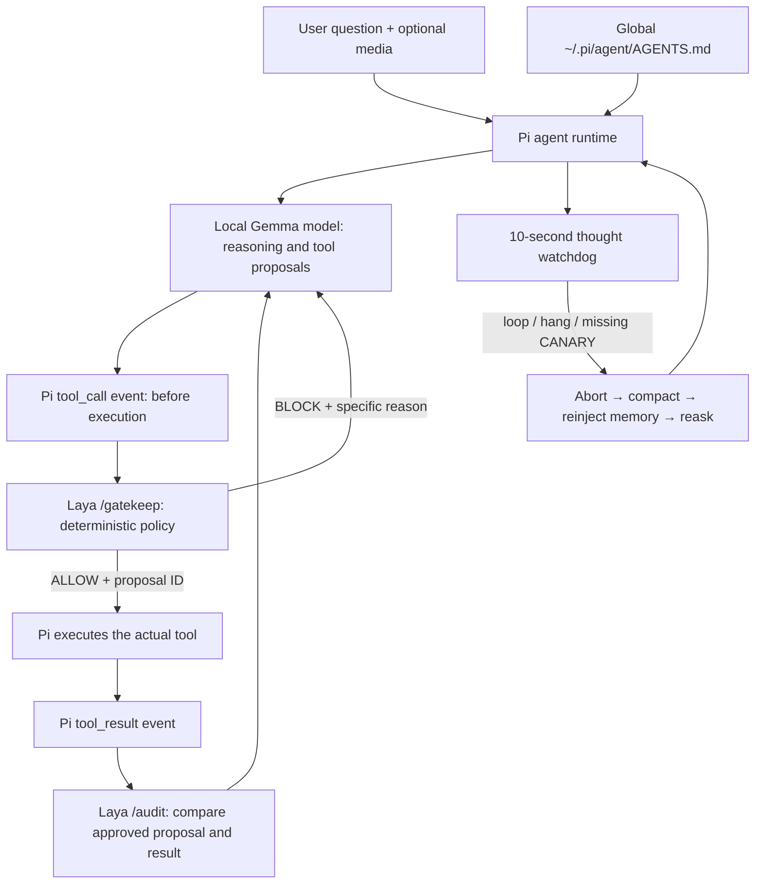
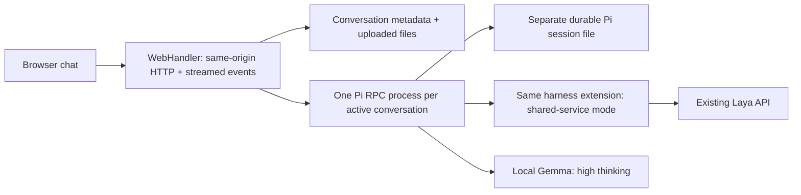

# Pi local AI harness

Start with `pi` after installing the extension (`python3 harness/install.py`), or use
`./start.sh`. The harness starts two local services and prints their actual ports:
Laya API (8000) and web interface (3000). Their console URLs are clickable terminal
hyperlinks; use your terminal’s link-opening gesture. Whisper loads only when audio is submitted.
See [configuration and installation](harness/README.md).

## Architecture: who does what

**Pi runs tools. Laya checks tools. The model proposes tools.** Laya never executes
shell strings itself, and the watchdog never decides shell safety.

## Exactly when Laya intervenes

1. The model finishes proposing a tool call. Pi emits `tool_call` **before** running it.
2. The extension sends the tool name, exact arguments, working directory, and profile
   to `/gatekeep`. Laya checks them without executing the command.
3. An allowed call receives a one-use proposal ID and runs normally.
4. A blocked call never runs. Its reason becomes model-visible tool feedback in the
   next reasoning step: what was dangerous, that nothing executed, and that it should
   choose a narrowly scoped alternative. Ordinary diagnostics remain available.
5. After execution, `/audit` consumes the original proposal ID. Changed tool/arguments,
   execution failures, and write/edit content mismatches become failed tool results.
   An unavailable gate fails closed; an unavailable audit cannot count as success.

Both `standard` and `admin` permit ordinary shell commands. Neither bypasses the
shell guard. `env`, `ls /`, `whoami`, builds, tests, and `rm -rf ./build` are allowed.
Broad deletion such as `rm -fr *`, root/home deletion, disk erasure, raw disk writes,
and recursive system permission changes are blocked. Common wrappers and shell
`-c` strings are checked too. [Exact rules and authoritative sources](specs/shell-safety.md).
This is a deterministic accident guard, not a sandbox for arbitrary scripts.

## Browser chat

Open the printed Web address (normally `http://127.0.0.1:3000`). The frontend is now
a chat workspace: create, switch, rename, and delete conversations in the left sidebar;
on narrow screens the menu button opens that sidebar as a drawer. Drop files, use the
attachment button, paste images, or record audio with the microphone button. Responses,
reasoning, and tool activity stream as they happen; Stop cancels the current run.

A web conversation is its own Pi session, not a mirror of the terminal conversation.
Both use the same model configuration, global memory, watchdog, and Laya hooks. Web
workers reuse the existing Laya service; they do **not** start another API/web server.
The working directory follows the Pi session that started the services, unless
`PI_WEB_CWD` overrides it. Up to four web conversations may run concurrently.

Conversation metadata, Pi sessions, and uploads persist under
`~/.pi/agent/web-chat/` (`PI_WEB_DATA` overrides this). Closing the browser does not
cancel an in-progress task; reopening loads saved messages. Stop and server shutdown
terminate the owned Pi worker. Deleting a conversation deletes its session and uploads;
stop an active conversation before deleting it.

Supported attachments: PNG/JPEG/WebP/GIF images, common audio formats, and UTF-8
text/code files. Images go to Pi as image bytes. Audio is transcribed with lazy MLX
Whisper. Text file contents are included in the prompt. Unsupported binary formats
such as ZIP/PDF produce an explicit error. Limits: eight files, 12 MiB per file, and
32 MiB per HTTP request. The UI limits total raw attachments to 20 MiB.
Microphone recording requires browser permission and a supported MediaRecorder.

The server listens on loopback and rejects foreign browser origins. Mobile-ready
means the layout works on phone-size screens; access from a physical phone requires
a separate connection arrangement. It is not automatically exposed on your LAN.

## Recovery and memory

`harness/extension.mjs` observes Pi lifecycle events. Every ten seconds,
`harness/watch.mjs` checks the latest 100 nonempty thought lines for two
non-overlapping occurrences of the same three-line block. A thought phase with no
active Pi operation, or 60 seconds without streamed activity, triggers hang recovery.
Normal idle time and tool execution are exempt. Missing `[CANARY]` in completed
assistant text also triggers recovery. Pi exposes stream/operation state, not GPU state.

Recovery aborts the turn, waits for its end, compacts, reloads global `AGENTS.md`, and
reasks the original question with the previous reasoning and images. One automatic
retry is allowed per question. Current incident memory deduplicates fixed lessons by
kind; evidence-verified lesson promotion remains roadmap task 26.

## Files to read or change

| File | Responsibility |
|---|---|
| `.pi/extensions/local-harness.ts` | Installed Pi extension entry point |
| `harness/extension.mjs` | Startup, lifecycle hooks, recovery, and Laya calls |
| `harness/services.py` | Owns API/web sockets and service shutdown |
| `agent_api.py` | Laya HTTP routing; `/gatekeep` and `/audit` |
| `harness/web_chat.py` | Conversation storage, attachment decoding, Pi RPC workers, streamed web API |
| `index.html`, `chat.css`, `js/chat.mjs` | Responsive browser chat |
| `laya/engine.py` | Pre-action decision and post-action judgment |
| `laya/shell_guard.py` | Argument-sensitive destructive shell rules |
| `laya/ledger.py` | Immutable proposals, one-use IDs, file postconditions |
| `harness/media.mjs`, `harness/transcribe.py` | Image bytes and lazy audio transcription |
| `harness/timestamps.mjs` | Timestamp entries in the Pi console |
| `ROADMAP.md`, `tasks/` | Completed work and remaining work |

Check a safety change with `python3 -m unittest discover -s tests -p 'test_laya*.py'`
and `python3 -m unittest discover -s tests -p test_shell_guard.py`. Run the HTTP and
Pi integration tests described in [the harness guide](harness/README.md).
